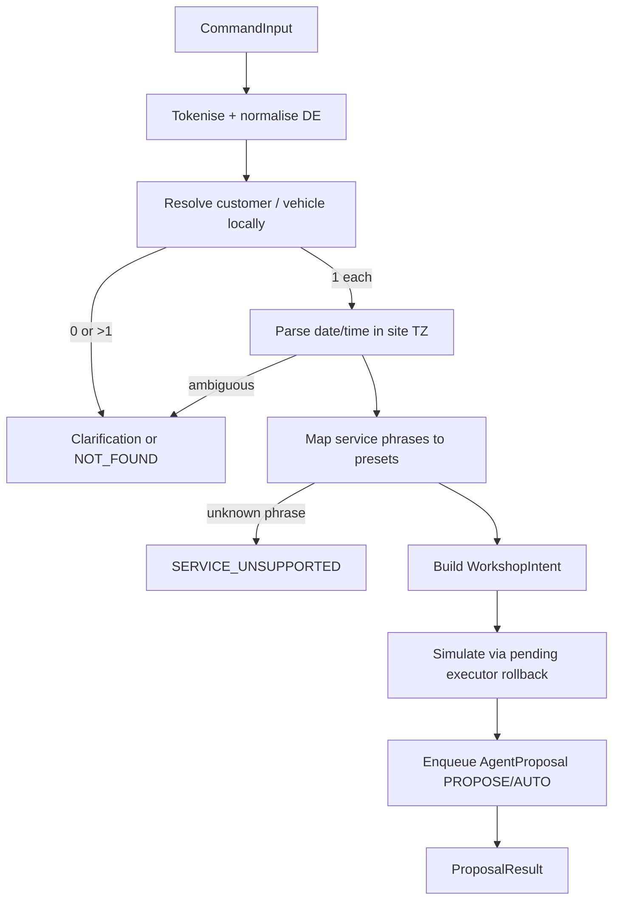

# Command-first workshop booking (sentence → workshop order)

## Summary

Service advisors already use **Global Search** (`Cmd+K`) to jump to customers, vehicles, and jobs. This feature adds a **command-first** path on the same surface: a short German sentence describes an appointment for an **existing** pilot customer and vehicle, optional **local service presets** (labor/parts templates), and an optional **loaner car**. A **local, deterministic interpreter** turns the sentence into a versioned `WorkshopIntent`, asks structured **clarifications** when data is ambiguous, runs a **rollback preview** (same semantics as pending actions / dry-run), and enqueues **one shared `AgentProposal` apply path**—never generic free-form tool execution.

The first delivery for AUT-515 is **spec + synthetic fixtures only** (this document and `apps/core-api/test/fixtures/command-first-workshop/`). Product orchestration code is a follow-up.

Out of scope here: new customer creation, supplier orders, payments, KVA send dialog, public customer approval, and communication timeline (those surfaces already exist and are not respecified).

---

## User Stories

- As a **Service Advisor**, I want to **type one German sentence in Global Search** so that **a scheduled workshop order draft is proposed with the right customer, vehicle, time, and services**.
- As a **Service Advisor**, I want **clear multiple-choice questions when a name, plate, or time is ambiguous** so that **the system never silently picks the wrong car or slot**.
- As a **Supervisor**, I want **the same Approvals queue and Apply button** as MCP pending actions so that **policy and audit stay centralized**.
- As a **Platform owner**, I want **no raw sentence containing names, plates, or VINs sent to OpenRouter/Jev** so that **the flow can ship without AUT-395 production gate**.

---

## Problem and entry points

| Area | Existing code | Role in this feature |
|------|---------------|----------------------|
| UI shell | `apps/core-web/src/components/GlobalSearch.tsx` | Command mode: submit `CommandInput`, render clarification choices or preview |
| Write contracts | `apps/core-api/src/mcp/mcp-tool-schemas.ts` (`draftWorkshopOrderInputSchema`, `proposeLineItemInputSchema`) | **Target payloads** after interpretation—not parsed from free text |
| Apply queue | `apps/core-api/src/pending-action-executor/pending-action-executor.service.ts` | `workshop_order.create` + `workshop_order.propose_line` executors |
| Policy | `apps/core-api/src/decision/decision.constants.ts` | **No new decision use case** in v1; Jev remains import/doc-sort only |
| Scheduling rules | `apps/core-api/src/workshop/workshop-schedule.service.ts` | `assertCanBook` for bay/window conflicts at apply time |
| Pending actions spec | [pending-actions.md](./pending-actions.md) | Single queue, `needs_approval`, site pinned on create |

---

## Versioned contracts (v1)

All JSON payloads carry `contract_version`. Breaking changes increment the path segment (`.../v2`).

| Contract | Purpose |
|----------|---------|
| `command-first-workshop/CommandInput/v1` | Client → API: raw utterance + UI metadata |
| `command-first-workshop/WorkshopIntent/v1` | Fully resolved intent (customer, vehicle, appointment, services, loaner) |
| `command-first-workshop/Clarification/v1` | Ambiguity: choices that **fill** missing intent fields |
| `command-first-workshop/ProposalResult/v1` | Result of preview + enqueue: links to `AgentProposal` |
| `command-first-workshop/BookingProposal/v1` | Fixed bay/window/loaner snapshot for acceptance tests |
| `command-first-workshop/PositionPlan/v1` | Labor lines to propose after order shell exists |

Example files (synthetic):

- `apps/core-api/test/fixtures/command-first-workshop/contracts/command-input.v1.example.json`
- `apps/core-api/test/fixtures/command-first-workshop/contracts/workshop-intent.v1.example.json`
- `apps/core-api/test/fixtures/command-first-workshop/contracts/clarification.v1.example.json`
- `apps/core-api/test/fixtures/command-first-workshop/contracts/clarification-vehicle-golf.v1.example.json`
- `apps/core-api/test/fixtures/command-first-workshop/contracts/proposal-result.v1.example.json`
- `apps/core-api/test/fixtures/command-first-workshop/fixed-booking-proposal.huber-golf.v1.json`
- `apps/core-api/test/fixtures/command-first-workshop/fixed-position-plan.huber-golf.v1.json`
- `apps/core-api/test/fixtures/command-first-workshop/pilot-tenant-snapshot.v1.json`
- `apps/core-api/test/fixtures/command-first-workshop/acceptance-corpus.v1.json`

### CommandInput / v1 (schema sketch)

```typescript
type CommandInputV1 = {
  contract_version: 'command-first-workshop/CommandInput/v1';
  utterance: string; // max 500 chars after trim
  client_context: {
    submitted_at: string; // ISO-8601 with offset
    ui_surface: 'global_search';
    locale: 'de-AT' | 'de-DE';
  };
};
```

### WorkshopIntent / v1 (schema sketch)

```typescript
type WorkshopIntentV1 = {
  contract_version: 'command-first-workshop/WorkshopIntent/v1';
  resolution: 'complete';
  site_id: string;
  site_timezone: string; // IANA, from site / tenant settings
  customer_id: string;
  vehicle_id: string;
  appointment: {
    kind: 'scheduled';
    local_date: string; // YYYY-MM-DD in site TZ
    local_start_time: string; // HH:mm
    local_end_time: string;
    scheduled_start_at: string; // UTC ISO
    scheduled_end_at: string;
    relative_source?: 'morgen' | 'übermorgen' | 'heute';
    anchor_interpreted_at: string;
  };
  service_lines: Array<{
    preset_id: string;
    matched_phrase: string;
    labor_operation_code: string;
    includes_pickerl: boolean;
  }>;
  loaner?: { requested: boolean; preference: 'reserve' };
  interpreter_trace: {
    engine: 'local_rules';
    provider: null;
    redacted_utterance_sha256: string; // hash only in logs/API
  };
};
```

### Clarification / v1 (schema sketch)

```typescript
type ClarificationV1 = {
  contract_version: 'command-first-workshop/Clarification/v1';
  resolution: 'needs_choice';
  question_id: string;
  prompt_de: string;
  choices: Array<{
    choice_id: string;
    label: string; // display only; may contain fictional plate
    fills: Partial<Pick<WorkshopIntentV1, 'customer_id' | 'vehicle_id'>> & {
      local_start_time?: string;
      local_date?: string;
      skip_loaner?: boolean;
    };
  }>;
  partial_intent: Record<string, unknown>;
  error_code: CommandFirstErrorCode;
};
```

### ProposalResult / v1 (schema sketch)

```typescript
type ProposalResultV1 = {
  contract_version: 'command-first-workshop/ProposalResult/v1';
  status: 'needs_approval' | 'executed' | 'refused';
  trace_id: string;
  pending_action_id?: string;
  policy: { action_type: string; tier: 'AUTO' | 'PROPOSE' | 'HUMAN_ONLY'; enabled: boolean };
  proposal: {
    provisional: boolean;
    booking_proposal_ref?: string;
    position_plan_ref?: string;
  };
  preview: { would_change: Array<{ entity: string; op: string; provisional: boolean }> };
  payload_json: unknown; // matches pending-action executor input
};
```

---

## Local interpreter (v1 executable approach)

### Principles

1. **Deterministic** — same tenant, site, anchor time, and utterance → same outcome.
2. **No silent guesses** — 0 or >1 customer/vehicle/preset/time match → `Clarification` or hard error, never “best effort”.
3. **No outbound PII** — the full `utterance` is processed **in-process only**. Logs store `redacted_utterance_sha256`. Optional `DecisionProvider` adapter may be wired later for **non-PII** gaps only; v1 does **not** register a decision use case and does **not** send the raw sentence (or name/plate/VIN substrings) to OpenRouter/Jev or any new external service. Completing v1 does not require AUT-395.
4. **Site timezone** — relative dates (`morgen`, `heute`, `übermorgen`) resolve using `get_tenant_settings` / site timezone (same source as workshop planner: `Europe/Vienna` in pilot fixtures).
5. **Bounded grammar** — unsupported tokens return `INTERPRETER_UNSUPPORTED_INPUT` or `SERVICE_UNSUPPORTED`; the model does not invent services.

### Supported input (v1)

| Category | Supported patterns | Notes |
|----------|-------------------|--------|
| Customer | Single token surname (`Huber`), `Nachname Kennzeichen` | Tenant-scoped search; max 25 candidates, then clarify |
| Vehicle | Model token (`Golf`), plate `W-XX 123` / `WXX123` | Normalise plate; match against pilot customer vehicles at active site |
| Date | `morgen`, `übermorgen`, `heute`, `DD.MM.`, `DD.MM.YYYY` | Anchor = `client_context.submitted_at` in site TZ |
| Time | `8 Uhr`, `08:00`, `8:30`, `um 14 Uhr` | Single start time; two times → `TIME_CONTRADICTORY` |
| Services | Phrases from tenant **service preset** table (local aliases) | `großes Service`, `Pickerl` / `§57a`, `Bremsen vorne prüfen` in pilot snapshot |
| Loaner | `Leihwagen`, `Ersatzwagen`, `Ersatzmobil` + `reservieren` / `brauche` | Maps to loaner booking proposal when fleet available |
| Connectors | `,`, `+`, `und` | Split service clauses only |

**Explicitly unsupported in v1:** new customer, VIN-only lookup, free-text labor without preset, mechanic name, bay name, “nächste Woche” without weekday, English utterances, voice audio.

### Resolution pipeline (server)



Implementation must batch DB reads (single query per entity type per request); **no query per token loop iteration**.

### Provider adapter (optional, post-v1)

A future adapter may call Jev only with **redacted features** (preset ids, choice indices, hashed tokens)—mirroring [decision-adapter.md](./decision-adapter.md). It is **not** part of AUT-515 delivery. Enabling raw-text provider interpretation requires a separate data-protection decision; AUT-395 gate unchanged.

---

## Canonical acceptance sentence

Utterance (from AUT-515, fictional pilot customer surname **Huber**):

> Huber Golf morgen 8 Uhr großes Service + Pickerl, Bremsen vorne prüfen, Leihwagen reservieren

**Step 1 — interpret** (`interpreted_at`: `2026-10-15T09:12:00+02:00`, site `WST-NORD`):

- Customer: uniquely **Huber, Maria** (`b2000000-0000-4000-8000-000000000001`).
- Vehicle: token `Golf` matches **two** vehicles for Maria → **`VEHICLE_AMBIGUOUS`** clarification (see `clarification-vehicle-golf.v1.example.json`). Choices: W-PI 101 vs W-PI 102.
- Time: `morgen` + `8 Uhr` → local `2026-10-16T08:00` → UTC `2026-10-16T06:00:00.000Z` (CEST).
- Services: presets inspection-large (+Pickerl bundle) and brake-front-check.
- Loaner: requested.

**Step 2 — after choice `choice_vehicle_wpi101`:**

- `WorkshopIntent` as in `workshop-intent.v1.example.json`.
- Preview + enqueue → `ProposalResult` with refs to **fixed booking** and **position plan** fixtures.

Pickerl is **not** duplicated as its own line when bundled via `includes_pickerl_task` on the inspection preset (`fixed-position-plan.huber-golf.v1.json`).

---

## No-silent-guess rules

| Situation | Behaviour |
|-----------|-----------|
| 0 customer matches | `CUSTOMER_NOT_FOUND` |
| >1 customer matches | `CUSTOMER_AMBIGUOUS` + choices |
| 0 vehicle matches | `VEHICLE_NOT_FOUND` |
| >1 vehicle matches | `VEHICLE_AMBIGUOUS` + choices |
| Customer at another site | `SITE_MISMATCH` |
| Two start times | `TIME_CONTRADICTORY` |
| Unknown service phrase | `SERVICE_UNSUPPORTED` |
| No bay free (at apply) | `BAY_UNAVAILABLE` (preview failure) |
| Loaner requested but none free | `LOANER_UNAVAILABLE` + choices (proceed without / pick other slot) |

---

## Preview and Apply

1. **Interpret** — `POST /api/workshop/command/interpret` → `WorkshopIntent` | `Clarification` | error.
2. **Continue** — `POST /api/workshop/command/interpret` with `resolution: { question_id, choice_id }` merges `fills` into session intent (server-side intent handle, not client-trusted UUIDs).
3. **Propose** — `POST /api/workshop/command/propose` builds:
   - `workshop_order.create` payload aligned with `draftWorkshopOrderInputSchema` (`status: SCHEDULED`, `bay_id`, UTC window).
   - Optional chained `workshop_order.propose_line` payloads from `PositionPlan` (separate proposals or one composite preview per product decision in implementation slice 2).
4. Uses **`AgentProposalService` submit** — same rollback simulation as [pending-actions.md](./pending-actions.md). `HUMAN_ONLY` actions are never invoked; no arbitrary MCP tool runner.
5. **Apply** — existing `POST /api/agent-proposals/:id/apply` (OWNER/ADMIN/ADVISOR). Site at apply must match simulation `site_id` (executor already pins `workshop_order.create`).

Customer-facing send (KVA), public approval, and timeline remain human flows; not triggered by this command path.

---

## Error codes

| Code | HTTP | Meaning |
|------|------|---------|
| `CUSTOMER_NOT_FOUND` | 404 | No tenant customer match |
| `CUSTOMER_AMBIGUOUS` | 409 | Clarification required |
| `VEHICLE_NOT_FOUND` | 404 | No vehicle for resolved customer/site |
| `VEHICLE_AMBIGUOUS` | 409 | Clarification required |
| `VEHICLE_CUSTOMER_MISMATCH` | 400 | Plate belongs to another customer |
| `SITE_MISMATCH` | 403 | Record not visible at active site |
| `TIME_AMBIGUOUS` | 409 | Incomplete date/time |
| `TIME_CONTRADICTORY` | 409 | Multiple incompatible times |
| `TIME_OUTSIDE_HOURS` | 400 | Outside workshop hours / holiday |
| `SERVICE_UNSUPPORTED` | 400 | Phrase not in preset map |
| `SERVICE_AMBIGUOUS` | 409 | Preset tie (v1: avoid via non-overlapping aliases) |
| `BAY_UNAVAILABLE` | 409 | `assertCanBook` conflict in preview |
| `LOANER_UNAVAILABLE` | 409 | Clarification or error |
| `INTERPRETER_UNSUPPORTED_INPUT` | 400 | Grammar outside v1 |
| `COMMAND_SESSION_EXPIRED` | 410 | Clarification session TTL exceeded |
| `POLICY_NOT_PERMITTED` | 403 | Tool disabled or `HUMAN_ONLY` |

---

## Database Impact

### New Tables / Columns

| Table | Column | Type | Nullable | Notes |
|-------|--------|------|----------|-------|
| `workshop_service_presets` | (new table) | — | — | Tenant-scoped alias → `labor_operation_id`, duration, flags |
| `workshop_service_presets` | `tenant_id` | UUID | NO | FK tenant |
| `workshop_service_presets` | `aliases_json` | JSONB | NO | Normalised phrases |
| `workshop_service_presets` | `includes_pickerl_task` | BOOLEAN | NO | Default false |
| `command_interpret_sessions` | (new table) | — | — | Short-lived clarification state (optional if JWT-bound cache used) |
| `command_interpret_sessions` | `expires_at` | TIMESTAMPTZ | NO | TTL 15 minutes |

### Modified Tables

| Table | Change | Migration Required? |
|-------|--------|---------------------|
| `agent_action_logs` | Optional `metadata_json.command_first_version` | Additive, optional |
| — | No change to `AgentProposal` shape | Reuse `payload_json` / `preview_json` |

### Deletion Policy Impact

- `workshop_service_presets` — tenant-scoped configuration; hard-delete allowed when unused (follow-up entry in `docs/deletion-policy.md` at implementation).
- `command_interpret_sessions` — ephemeral; hard-delete on expiry or TTL job; no audit retention requirement.

---

## API Contract Changes

### New Endpoints

| Method | Route | Request Body | Response | Auth |
|--------|-------|-------------|----------|------|
| `POST` | `/api/workshop/command/interpret` | `CommandInputV1` + optional `resolution` | `WorkshopIntentV1` \| `ClarificationV1` \| error | OWNER, ADMIN, ADVISOR |
| `POST` | `/api/workshop/command/propose` | `{ intent_id \| inline WorkshopIntentV1 }` | `ProposalResultV1` | Same |
| `GET` | `/api/workshop/service-presets` | — | List presets for UI hints | Same |

### Modified Endpoints

| Method | Route | Change Description |
|--------|-------|--------------------|
| — | — | None in AUT-515 (spec only) |

### OpenAPI Regeneration

- [ ] `npm --prefix apps/core-api run openapi:generate` (implementation PR)
- [ ] `npm --prefix apps/core-web run api:types:generate` (implementation PR)

---

## Tenancy and authorization

- **Tenant** from authenticated session (`TenantContextService`); never from request body.
- **Active site** from session; server verifies membership and that customer/vehicle/bay/loaner rows belong to that site (or tenant-wide vehicle with site visibility rules matching existing workshop APIs).
- **Do not** infer site from a client-side site switcher payload after interpret; re-check on propose and apply.
- Roles: interpret/propose — `OWNER`, `ADMIN`, `SERVICE_ADVISOR` (ADVISOR); apply — same as existing agent proposals.

---

## UX Compliance

### Layout & Actions

- [ ] Command mode in Global Search: primary action **Preview booking** top-right of preview panel.
- [ ] Clarification choices as full-width buttons (no silent default selection).
- [ ] Page-level workshop flows unchanged; this is a modal command palette.

### List Pages (if applicable)

- [ ] N/A (no new list page in v1).

### Form Handling

- [ ] Utterance field debounced submit on Enter; clarifications do not auto-submit.

### Real-Time Sync

- [ ] After Apply, existing `WorkshopOrder` entity sync via current dashboard map (no new entity type).

---

## Component Design

| Component | Location | Purpose |
|-----------|----------|---------|
| `GlobalSearch` (extend) | `apps/core-web/src/components/GlobalSearch.tsx` | Detect command prefix or dedicated mode; call interpret API |
| `WorkshopCommandPreview` | `apps/core-web/src/components/global-search/` (new) | Show intent, loaner, lines, link to Approvals |
| `WorkshopCommandClarification` | same | Render `ClarificationV1` choices |

---

## Synthetic acceptance corpus

File: `apps/core-api/test/fixtures/command-first-workshop/acceptance-corpus.v1.json`

| case_id | Covers |
|---------|--------|
| `canonical-huber-golf-step1-vehicle` | Canonical AUT-515 sentence → vehicle clarification |
| `canonical-huber-golf-step2-after-choice` | Fixed booking + position plan |
| `ambiguous-huber-only` | Multiple pilot customers named Huber |
| `ambiguous-two-golf-same-customer` | Two Golf vehicles |
| `customer-not-found` | No match |
| `dst-spring-forward` | `Europe/Vienna` DST boundary |
| `relative-morgen-at-midnight` | `morgen` at `00:00` site-local |
| `unsupported-service` | Unknown phrase |
| `wrong-site-vehicle` | `SITE_MISMATCH` |
| `contradictory-time` | Two times in one sentence |
| `loaner-unavailable` | Loaner choice path |

---

## Implementation slices (post-spec)

| Slice | Deliverable | Depends on |
|-------|-------------|------------|
| **S1** | `workshop_service_presets` CRUD (admin) + seed pilot aliases | Migration |
| **S2** | `CommandInterpretService` local grammar + tests against acceptance corpus | S1 |
| **S3** | REST interpret/propose + OpenAPI + Global Search UI preview | S2 |
| **S4** | Loaner hook in propose preview (loaner booking pending action if separate policy added) | Loaner APIs |
| **S5** | Position plan → `workshop_order.propose_line` chain | S3 |
| **S6** (optional) | Non-PII provider adapter behind feature flag | ADR + AUT-395 |

---

## Testing Plan

### Backend E2E

- [ ] Corpus-driven tests: load `acceptance-corpus.v1.json` + `pilot-tenant-snapshot.v1.json` in memory repository.
- [ ] Assert UTC instants for DST and midnight `morgen` cases.
- [ ] Propose path returns `needs_approval` when policy tier `PROPOSE`.

### Frontend

- [ ] Extend `GlobalSearch.navigation.test.tsx` with mocked interpret responses (implementation).

### Privacy tests

- [ ] Assert no HTTP call to OpenRouter when `DECISION_PROVIDER=openrouter-jev` during interpret (network guard / unit test).

---

## State / policy interactions

| Action | Default platform tier (expected) | Notes |
|--------|----------------------------------|-------|
| `workshop_order.create` | PROPOSE (tenant may enable AUTO) | Maps to `draft_workshop_order` |
| `workshop_order.propose_line` | PROPOSE | Position plan lines |
| Invoice send / finalize | HUMAN_ONLY | Never exposed |

---

## Open Questions

1. Should position-plan lines be **one** composite proposal or **N** line proposals after order create? Recommendation: one booking proposal first; lines in slice S5.
2. Admin UI for `workshop_service_presets` vs seed-only for pilot tenant?

---

## References

- [pending-actions.md](./pending-actions.md)
- [decision-adapter.md](./decision-adapter.md) — PII rules; no new use case in v1
- [mcp-server.md](./mcp-server.md) — `draft_workshop_order` shape
- [loaner-vehicles.md](../Workshop/loaner-vehicles.md)
- [2026-08-21-workshop-planner-calendar.md](../Workshop/2026-08-21-workshop-planner-calendar.md)
- [customer-communication-and-approvals.md](../Workshop/customer-communication-and-approvals.md) — existing; not rebuilt here
- [[README|Vault Conventions]]

---

## Linear Tracking

| Field | Value |
|-------|-------|
| Project | Agent-era foundation |
| Milestone | Command-first workflows and decision inbox |
| Issues | AUT-515 (parent AUT-392) |
