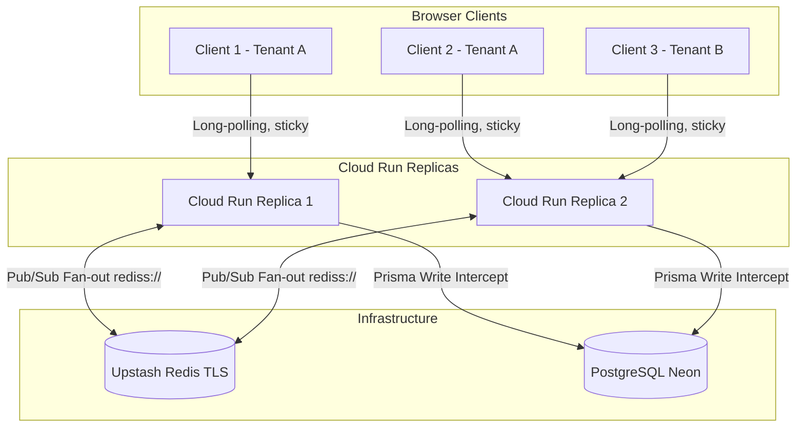

# Socket.IO Realtime & Multi-Instance Redis Scaling Runbook

This runbook guides operators, platform administrators, and engineers on configuring, running, and scaling Socket.IO realtime communication across Cloud Run instances in Auto Core Platform.

---

## 1. Architecture Overview

Auto Core Platform uses Socket.IO (`/dashboard-realtime` namespace with path `/api/socket.io`) to stream mutations (`entity_updated` events and `auth:claims_updated` events) to connected frontend clients in real time.

Production Redis is **Upstash** (public TLS `rediss://`). Cloud Run reaches it over the internet. There is **no VPC connector and no Memorystore**.



### Cloud Run WebSocket Requirements

`core-api` runs with **request-based billing** (CPU is allocated only while a request or connection is open). Socket.IO works with this: CPU is allocated while a WebSocket/long-polling connection is open, and the Redis adapter handles multiple instances.

These flags apply **only to `core-api`**, not `core-api-pdf-worker` (set via `cloudbuild.yaml`, PR #669):

- **`--min-instances 0`**: Scale to zero when idle. After idle, the first connection hits a cold start; the client reconnects automatically. A few realtime events may be missed meanwhile, and the app refetches via REST.
- **`--cpu-throttling`**: Request-based billing (default). Do not use `--no-cpu-throttling` or `--min-instances 1` without a concrete reason.
- **`--max-instances 5`**: Horizontal scale-out. Safe only together with `--session-affinity` (long-polling sessions stay on one replica) and `REDIS_URL` (the Socket.IO Redis adapter fans room broadcasts across replicas).

**Cost warning:** an always-on instance (`--min-instances 1` with `--no-cpu-throttling`) costs roughly 70+ USD/month per instance and caused the September 2026 cost spike. Do not reintroduce it without a reason.

### Transports: long-polling only behind Firebase Hosting

The browser client connects with `transports: ['polling']` and `upgrade: false` (`apps/core-web/src/features/realtime/realtime-socket-options.ts`). Firebase Hosting serves the app and rewrites `/api/**` to `core-api` (`firebase.json`). **Assumed, not verified:** the rewrite does not forward WebSocket upgrades. An earlier version of this runbook stated it as fact. The reported `HTTP 400` handshakes ("Unexpected response code: 400" in Chrome) match the assumption. Polling avoids the WebSocket attempt either way. If the assumption is wrong, polling is less efficient than WebSocket, but it still works.

The Firebase documentation was unreachable from the build environment in AUT-432, and no live probe ran. The local reproduction covers replica behaviour, not Hosting. The post-deploy checks in section 4 test the assumption on the live host.

Read a `400` on `/api/socket.io` as a defect signal, not as expected noise. The log entry `ws_engine_connection_error` is a JSON object written as text. Its fields say which path failed:

| JSON fields in the log text | Meaning | Action |
|---|---|---|
| `"code":1`, `"message":"Session ID unknown"` | A poll or upgrade reached a replica that does not hold the session. | Affinity is not reaching Cloud Run. See the remaining infra step in section 4. |
| `"code":3`, `"transport":"websocket"`, `"upgradeHeader":false` | An upgrade was requested but its headers were dropped on the way. | Check Hosting routing for `/api/**`. |

### Session affinity for long-polling

Socket.IO keeps each engine.io session in memory on the replica that created it. The Redis adapter fans room broadcasts out across replicas, but it does not move sessions. A polling client sends its `sid` on every request. Without affinity, requests reach random replicas and fail with `Session ID unknown`, which then triggers reconnects. This was the second part of the AUT-432 reconnect loop. The local reproduction (engine.io 6.6.11, two replicas, no affinity) returned exactly this `400` for a `sid` sent to the other replica.

`cloudbuild.yaml` deploys `core-api` with `--session-affinity`, and `infra/main.tf` sets `session_affinity = true` so a Terraform apply does not remove it. Cloud Run's session affinity uses a cookie on responses (not re-checked against Google's documentation in AUT-432). Whether Firebase Hosting passes that cookie back to Cloud Run is **not verified**. Section 4 has the check and the fallback options.

Do not copy the Socket.IO flags onto the Playwright PDF worker.

### Redis Pub/Sub Adapter

When `REDIS_URL` is set, `DashboardGateway` creates pub/sub Redis clients and attaches `@socket.io/redis-adapter` so room broadcasts (`tenant_{tenantId}`, `user_{userId}`) fan out across all replicas.

If `REDIS_URL` is unset, `DashboardGateway` falls back to the in-memory adapter (local development and e2e testing). In-memory mode must not run with `--max-instances > 1` in production: a mutation on replica A would not notify sockets on replica B.

---

## 2. Production Redis: Upstash (current)

Production uses Upstash Redis on the free tier as a public TLS endpoint. Do **not** add a Serverless VPC Access connector or Direct VPC egress for this path. Do **not** provision Memorystore unless the team later leaves Upstash for a private GCP Redis.

### Why not Memorystore / VPC

Memorystore uses private RFC 1918 addresses, so Cloud Run would need VPC egress. That is extra GCP cost. Upstash is reachable as `rediss://` from Cloud Run without VPC. Stay on Upstash until the command quota is a real problem; then pay Upstash, not Memorystore, unless there is a separate reason to keep Redis inside GCP.

### Free-tier limits

Upstash free tier is capped (currently **500,000 commands per month**). Socket.IO Redis adapter uses pub/sub plus connection overhead. Prefer an Upstash region close to Cloud Run (`europe-west3`). Watch the Upstash console for command volume. If the quota binds, upgrade the Upstash plan rather than adding GCP VPC + Memorystore by default.

### Step 2.1: Store `REDIS_URL` in Google Secret Manager

The GSM secret name must be exactly `REDIS_URL`. Value is the Upstash TLS URL, for example `rediss://default:<TOKEN>@<HOST>.upstash.io:6379`.

```bash
echo -n "rediss://default:<TOKEN>@<HOST>.upstash.io:6379" | \
  gcloud secrets versions add REDIS_URL \
    --data-file=- \
    --project=auto-core-platform-vande
```

If the secret does not exist yet:

```bash
echo -n "rediss://default:<TOKEN>@<HOST>.upstash.io:6379" | \
  gcloud secrets create REDIS_URL \
    --data-file=- \
    --project=auto-core-platform-vande
```

Grant the Cloud Run service account access:

```bash
gcloud secrets add-iam-policy-binding REDIS_URL \
  --member="serviceAccount:<SERVICE_ACCOUNT>@auto-core-platform-vande.iam.gserviceaccount.com" \
  --role="roles/secretmanager.secretAccessor" \
  --project=auto-core-platform-vande
```

`cloudbuild.yaml` already maps `--set-secrets …,REDIS_URL=REDIS_URL:latest` on `core-api` only.

---

## 3. Cloud Run scale-out (already wired)

`deploy-cloud-run` for `core-api` includes:

- `REDIS_URL=REDIS_URL:latest`
- `--min-instances 0`
- `--cpu-throttling` (request-based billing)
- `--max-instances 5`
- `--session-affinity`: long-polling sessions stay on one replica. Required with `--max-instances 5`; see "Session affinity for long-polling" in section 1.
- no `--vpc-connector` / Direct VPC flags

PDF worker deploy stays `--min-instances 0 --max-instances 2` without `REDIS_URL`.

---

## 4. Verification & Diagnostics

### Handshake auth vs Redis connect

Nest does not await `afterInit`. JWT handshake middleware is registered **synchronously first**. Redis connect runs in the background and is **awaited on `onApplicationBootstrap`**, which Nest does await during `init()` (before `listen()`).

Connect is bounded by `REDIS_CONNECT_TIMEOUT_MS` (10s) so ioredis retry cannot hang boot forever.

### Eager connection & fail-closed safety

When `core-api` boots with `REDIS_URL` set:

1. `DashboardGateway` eagerly connects `pubClient` and `subClient` before attaching the adapter.
2. The success log is emitted only after both clients connect:

   ```
   [DashboardGateway] Attached Redis adapter to Socket.IO for cross-instance fan-out.
   ```

3. **Fail-closed in production**: In `NODE_ENV=production`, if `REDIS_URL` is set but connect fails or times out, `onApplicationBootstrap` throws a `CRITICAL` error. Nest `init()` fails and Cloud Run does not serve traffic on a split-brain in-memory adapter.
4. If a connection drops post-startup, client errors are logged:

   ```
   [DashboardGateway] Redis pub client error: …
   ```

### Multi-instance realtime verification

1. Connect Browser Client A to Replica 1 and Browser Client B to Replica 2 (both logged into Tenant A).
2. Perform a mutation on Client A (e.g. update a customer or workshop order).
3. Verify that Client B receives `entity_updated` immediately and invalidates the corresponding TanStack Query cache.

---

### Post-deploy realtime checks

Run these after the next `core-api` release. The tag pipeline applies `--session-affinity` with that release. Checks 1 to 4 use the Hosting site `https://auto-core-platform-vande.web.app`, the site named in AUT-432. Check 5 also uses the Cloud Run service URL. All checks are read-only.

1. **Browser.** Sign in and watch the console for 5 minutes. Expect no `WebSocket connection ... failed` messages and no repeated `400` on `/api/socket.io`. The Network tab should show only `transport=polling` requests.
2. **Cloud Logging.** Filter `textPayload:"ws_engine_connection_error"` over 30 minutes of normal use. The gateway writes a JSON object as text through Nest's console logger, so the entry arrives as `textPayload`, not `jsonPayload`. Expect no `"code":1` (`Session ID unknown`) lines. Read this with check 3, which is the count of record. If check 3 shows 400s but check 2 has no `ws_engine_connection_error` lines at all, the logging is not wired, so check 2 is not a pass.
3. **Cloud Run request logs.** Count `httpRequest.status=400` for `httpRequest.requestUrl:"/api/socket.io/"`. Expect close to zero.
4. **Affinity through Hosting** (read-only, no state change). Use one cookie jar:

   ```bash
   curl -sS -c jar.txt -b jar.txt -i "https://auto-core-platform-vande.web.app/api/socket.io/?EIO=4&transport=polling"
   # Copy the sid from the "0{...}" open packet, then poll repeatedly with the same jar.
   curl -sS -c jar.txt -b jar.txt -o /dev/null -w "%{http_code}\n" --max-time 5 "https://auto-core-platform-vande.web.app/api/socket.io/?EIO=4&transport=polling&sid=<SID>"
   ```

   A `400` whose body is `Session ID unknown` means the affinity cookie is not reaching Cloud Run. A request held open until the timeout is a normal long-poll.
5. **WebSocket upgrade through Hosting** (read-only). This is the live test of the assumption in section 1. The probe goes through Hosting:

   ```bash
   curl -sS -i --http1.1 --max-time 8 \
     -H "Connection: Upgrade" -H "Upgrade: websocket" \
     -H "Sec-WebSocket-Version: 13" -H "Sec-WebSocket-Key: dGhlIHNhbXBsZSBub25jZQ==" \
     "https://auto-core-platform-vande.web.app/api/socket.io/?EIO=4&transport=websocket" | head -n 1
   ```

   A status other than `HTTP/1.1 101 Switching Protocols` through Hosting is consistent with the assumption. Only the comparison below tells a Hosting failure from a Cloud Run failure. Run the same request against the Cloud Run service URL, which `gcloud run services describe core-api --region=europe-west3 --project=auto-core-platform-vande --format='value(status.url)'` prints, and append the same path and query. A `101` there shows that Cloud Run accepts the upgrade. If Hosting returns `101`, the assumption is refuted, and the polling-only choice becomes a performance trade-off to revisit.

### Remaining infra step (outside the repo)

The repo change does not apply to the live service until the next `core-api` release. One step cannot be done from code:

1. **Verify** that Firebase Hosting returns the Cloud Run affinity cookie to the browser and forwards it on `/api/**`. Run check 4 above with more than one replica running.
2. **If the cookie is not forwarded**, pick one option and record the decision here before closing AUT-432:
   - **(a)** Run one replica: `gcloud run services update core-api --region=europe-west3 --project=auto-core-platform-vande --max-instances=1`. Realtime stays correct, but capacity drops to one instance (`--concurrency 40`).
   - **(b)** Connect the socket to the Cloud Run origin directly through `VITE_SOCKET_BASE_URL`, which `resolveRealtimeConnection` reads. Since AUT-747 the client then uses `transports: ['websocket', 'polling']` (WebSocket sessions need no affinity; polling is only the fallback and keeps `withCredentials` for the Cloud Run affinity cookie). This is a build change, and CORS (`FRONTEND_URL`) must list the exact Hosting origin(s) (no wildcard). The Cloud Run request timeout (300 s) cuts WebSocket connections; the client reconnects and then invalidates the realtime-backed queries by their targeted keys, and does the same when a hidden tab shows again. The gateway also closes each realtime session after `REALTIME_MAX_CONNECTION_AGE_MS` (default 30 minutes, 0 turns it off); the client reconnects on its retry backoff, which runs the token check again, so revoked sessions stop receiving events. A WebSocket handshake with an `Origin` header must come from an origin in `FRONTEND_URL` (`allowRequest`). Setting the variable in the production build needs explicit approval.

Terraform already matches the cloudbuild flag, so a Terraform apply keeps affinity on.

---

## 5. Local Development & E2E Testing

For local development and automated e2e test runs:

- Leave `REDIS_URL` unset in `.env` / test environment.
- Socket.IO runs in in-memory mode without Upstash or Docker Redis.
- To test multi-replica fan-out locally, run Redis (`docker run -p 6379:6379 redis:7`) and set `REDIS_URL=redis://localhost:6379`, or point at an Upstash `rediss://` URL.
